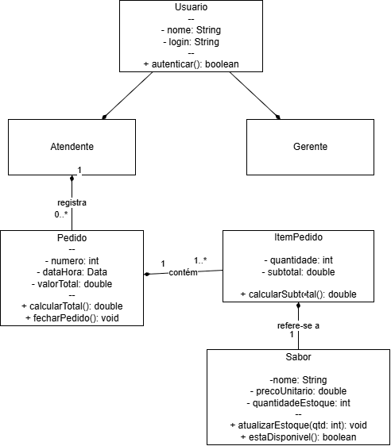

# 4.2.3 Modelagem de Classes

## Dos substantivos às classes

Para descobrir o que o sistema do IceTech precisa guardar na memória, analisamos os substantivos presentes no fluxo de **Registrar pedido** (Seção 4.2.2) e na lista de requisitos (Seção 4.2.1). 

Nem tudo o que apareceu no texto virou classe. Aplicamos três filtros de análise: o que era apenas um detalhe virou atributo (como a quantidade em estoque), o que era parte da interface foi ignorado (telas e botões), e o que estava no mundo físico fora do software também ficou de fora (o balcão da sorveteria).

| Substantivo | De onde veio | Vira | Por quê |
|---|---|---|---|
| atendente | ator da 4.2.2, passo 1 | classe **Atendente** | o sistema precisa saber quem operou o caixa e registrou a venda |
| gerente | ator da 4.2.2 | classe **Gerente** | responsável por ajustar o estoque e cadastrar novos sabores |
| usuário / login | RNF de acesso | classe **Usuario** | tanto o atendente quanto o gerente fazem login; o que é comum subiu para a classe geral |
| sabor / produto | passos 2 e 3 do fluxo, RF02, RF03 | classe **Sabor** | o produto vendido na sorveteria (ex: Chocolate, Morango) |
| estoque | passos 2 e 6, RF04 | atributo de **Sabor** | é um detalhe do sabor, não uma coisa que existe sozinha no sistema |
| pedido | passos 1 e 6, RF01, RF05 | classe **Pedido** | é a comanda digital que registra a venda no balcão do Chico |
| item do pedido | passo 3 do fluxo ("seleciona o sabor e a quantidade") | classe **ItemPedido** | classe necessária para guardar cada sabor e sua respectiva quantidade dentro de um mesmo pedido |

## Classes

Mapeamos seis classes para o IceTech. Cada atributo e operação foi extraído diretamente de um passo do fluxo principal ou de um requisito funcional.

| Classe | Atributos | Operações | Veio de |
|---|---|---|---|
| **Usuario** | - nome: String, - login: String | + autenticar(): boolean | RNF de acesso: identifica quem está operando o sistema |
| **Atendente** | _herda de Usuario_ | _nenhuma própria_ | ator que registra os pedidos no balcão |
| **Gerente** | _herda de Usuario_ | _nenhuma própria_ | RNF de permissão: só o gerente altera cadastros e estoque |
| **Sabor** | - nome: String, - precoUnitario: double, - quantidadeEstoque: int | + atualizarEstoque(qtd: int): void, + estaDisponivel(): boolean | RF02 (consulta), RF03 (cadastro) e passo 2 do fluxo |
| **Pedido** | - numero: int, - dataHora: Data, - valorTotal: double | + calcularTotal(): double, + fecharPedido(): void | RF01, RF05 e passos 4 e 6 do fluxo de venda |
| **ItemPedido** | - quantidade: int, - subtotal: double | + calcularSubtotal(): double | passo 3 do fluxo ("informa a quantidade de bolas/potes") |

## Diagrama de classes

**Figura 2 – Diagrama de classes do IceTech**

Fonte: Autoria própria (2026).

A Figura 2 traz as relações entre as seis classes do sistema. 

Usamos **herança** (triângulo vazado) apontando para `Usuario`, pois `Atendente` e `Gerente` são tipos de usuários do sistema e compartilham o mesmo mecanismo de login. 

A ligação entre `Atendente` e `Pedido` é uma **associação** simples: um atendente pode registrar de zero a vários pedidos (`0..*`), enquanto cada pedido é registrado por exatamente um atendente (`1`).

Para a relação entre `Pedido` e `ItemPedido`, aplicamos o teste da **composição** (losango cheio do lado do `Pedido`): se o Chico cancelar ou apagar um pedido do sistema, os itens daquela comanda perdem o sentido e somem junto. Um item de pedido não existe solto no sistema. A multiplicidade `1..*` garante que nenhum pedido pode ser aberto sem pelo menos um item. Por fim, cada `ItemPedido` está associado a exatamente um `Sabor` (`1`).

## Teste de objetos

Para validar se as multiplicidades do diagrama sustentam a rotina real do cliente, simulamos uma venda no balcão da sorveteria.

**A situação:** O atendente Lucas registrou o pedido nº 101, onde o cliente pediu duas bolas de Chocolate e uma bola de Morango.

**Figura 3 – Diagrama de objetos: simulação de uma venda no balcão do Chico**

Fonte: Autoria própria (2026).

| Objeto | Classe | Valores |
|---|---|---|
| `lucas` | Atendente | nome = "Lucas", login = "lucas.atendimento" |
| `choc` | Sabor | nome = "Chocolate", precoUnitario = 6.00, quantidadeEstoque = 48 |
| `morang` | Sabor | nome = "Morango", precoUnitario = 6.00, quantidadeEstoque = 30 |
| `ped101` | Pedido | numero = 101, dataHora = hoje, valorTotal = 18.00 |
| `item1` | ItemPedido | quantidade = 2, subtotal = 12.00 |
| `item2` | ItemPedido | quantidade = 1, subtotal = 6.00 |

**Ligações:** `lucas` ligado a `ped101`; `ped101` ligado a `item1` e `item2`; `item1` ligado a `choc`; `item2` ligado a `morang`.

**O que o teste confirma:**
- **Um atendente registra vários pedidos:** o objeto `lucas` está conectado ao `ped101` e pode se ligar a quantos outros pedidos registrar no dia.
- **Um pedido é composto por um ou mais itens:** o `ped101` contêm dois objetos distintos (`item1` e `item2`), validando a relação de composição `1..*`.
- **Separação entre o item e o produto:** o teste provou que precisamos da classe `ItemPedido`. Sem ela, o sistema não saberia que o `ped101` levou quantidades diferentes de sabores diferentes na mesma compra.

## Rastreabilidade com a 4.2.2

| Operação ou atributo | Classe | De onde veio |
|---|---|---|
| autenticar() | Usuario | RNF de identificação e controle de acesso |
| atualizarEstoque(), estaDisponivel() | Sabor | passo 2 (conferência) e passo 6 (baixa no estoque) do fluxo |
| calcularTotal(), fecharPedido() | Pedido | passo 4 (cálculo) e passo 6 (finalização) do fluxo |
| quantidadeEstoque | Sabor | passo 2 do fluxo ("sistema exibe quantidade disponível") |
| valorTotal | Pedido | passo 4 do fluxo ("exibe o total da compra") |

**Toda operação tem origem.** Não inserimos nenhum método ou atributo por intuição; todos derivam diretamente de uma necessidade descrita nos requisitos da 4.2.1 ou dos passos da 4.2.2.

**Todo passo automatizado tem casa.** As ações que o software executa durante o atendimento (como verificar se há sorvete no pote, somar os valores e descontar do estoque) encontraram uma classe responsável para executá-las.