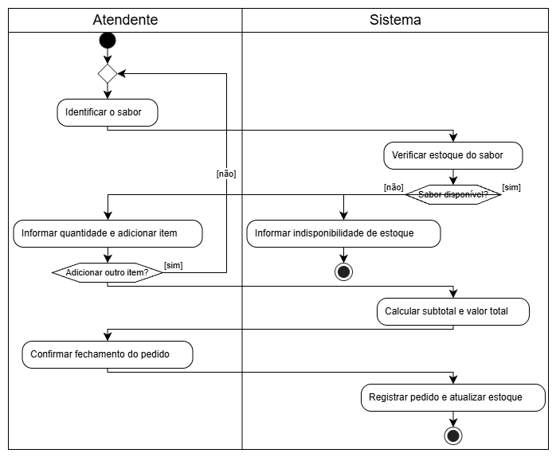

# 4.2.5 Modelagem de Atividade

## Do fluxo ao diagrama

O diagrama de atividades mapeia o fluxo comportamental do caso de uso **UC02 – Registrar Pedido**. A fonte é a especificação escrita na Seção 4.2.2, incluindo o fluxo principal, o fluxo alternativo A1 e a exceção E1. Nenhuma ação ou decisão foi adicionada sem respaldo da especificação prévia.

Cada passo do fluxo foi traduzido em uma ação posicionada na raia do responsável por executá-la. Passos que exigem verificação foram desdobrados em decisões com guardas `[sim]` e `[não]`. Alternativos retornam ao fluxo principal por meio de junções, e exceções conduzem a fins específicos sem atingir a pós-condição.

| No fluxo da 4.2.2 | Vira | Raia | Por quê |
|---|---|---|---|
| passo 1: o atendente identifica o sabor | ação **Identificar o sabor** | Atendente | ação executada pelo ator humano no balcão |
| passo 2: o sistema verifica a disponibilidade do sabor no estoque | ação **Verificar estoque do sabor** e decisão _sabor disponível?_ | Sistema | verificar exige uma pergunta lógica. A exceção E1 deriva do resultado negativo `[não]` |
| E1: sabor sem estoque suficiente, o sistema avisa e encerra | saída `[não]` da decisão, ação **Informar indisponibilidade de estoque** e **fim** próprio | Sistema | exceção não volta. O caso de uso encerra sem a pós-condição (sem registrar pedido) |
| passo 3: o atendente informa a quantidade e adiciona o item | ação **Informar quantidade e adicionar item** | Atendente | entrada de dados pelo ator no balcão |
| A1: adicionar outro sabor ao mesmo pedido | decisão _adicionar outro item?_, saída `[sim]` para **junção** antes de Identificar o sabor | Atendente | alternativo é um desvio que retorna ao fluxo principal via junção |
| passo 4: o sistema calcula o subtotal e o valor total do pedido | ação **Calcular subtotal e valor total** | Sistema | processamento automático dos valores dos itens inseridos |
| passo 5: o atendente confirma o fechamento do pedido | ação **Confirmar fechamento do pedido** | Atendente | validação final e encerramento da entrada de dados pelo ator |
| passo 6: o sistema registra o pedido e atualiza a quantidade em estoque | ação **Registrar pedido e atualizar estoque**, e o **fim** do caminho feliz | Sistema | o passo que entrega a pós-condição. É o único fim com ela |

## Diagrama de atividades

**Figura 5 – Diagrama de atividades de Registrar pedido**

Fonte: Autoria própria (2026).

A Figura 5 organiza o fluxo em duas raias verticais: a da esquerda é do **Atendente**, a da direita é do **Sistema**. Cada ação está na raia de quem a faz, e as setas cruzam de uma raia para a outra toda vez que a vez passa de um para o outro. Lendo de cima para baixo, o desenho é a conversa de balcão da 4.2.2.

O círculo cheio no alto é o **início**. Logo abaixo dele há uma **junção**, o losango sem pergunta: é por ali que o caminho do A1 volta, permitindo adicionar mais itens ao mesmo pedido. As duas **decisões** utilizam losangos com perguntas diretas e guardas explícitas entre colchetes: `[sim]` e `[não]`.

Há dois **fins**. O de baixo, na raia do Sistema, é o único em que a pós-condição acontece: o pedido registrado e o estoque atualizado. O fim da direita é o fim da exceção E1, e diz que a operação encerrou sem a pós-condição.

## Rastreabilidade com a 4.2.2

| Elemento do diagrama | Vem de | Confere |
|---|---|---|
| Identificar o sabor, Informar quantidade e adicionar item, Confirmar fechamento do pedido | passos 1, 3 e 5 (o atendente) | três ações na raia do ator, uma por passo do atendente |
| Verificar estoque do sabor, Calcular subtotal e valor total, Registrar pedido e atualizar estoque | passos 2, 4 e 6 (o sistema) | três ações na raia do sistema. São as mesmas que a 4.2.3 transformou em operações: `estaDisponivel()`, `calcularTotal()` e `fecharPedido()` |
| sabor disponível? [não] | E1 (no passo 2) | termina em fim próprio de exceção, sem a pós-condição |
| adicionar outro item? [sim] | A1 (no passo 3) | volta por junção para a ação Identificar o sabor |
| fim com a pós-condição | pós-condição da 4.2.2 | só o caminho feliz chega nele |

**Todo passo tem elemento.** Os seis passos do fluxo principal, o A1 e a E1 estão no desenho, e nenhum elemento do desenho veio de fora da especificação.

**Toda decisão tem as duas saídas.** Cada losango com pergunta tem um `[sim]` e um `[não]`, e cada saída leva a um lugar da especificação: o fluxo principal, o A1 ou a E1.

**O que a análise confirmou.** As três ações do Sistema na raia da direita conectam-se diretamente com os métodos definidos nas classes `Sabor`, `Pedido` e `ItemPedido` na Seção 4.2.3, garantindo a rastreabilidade nos dois sentidos.